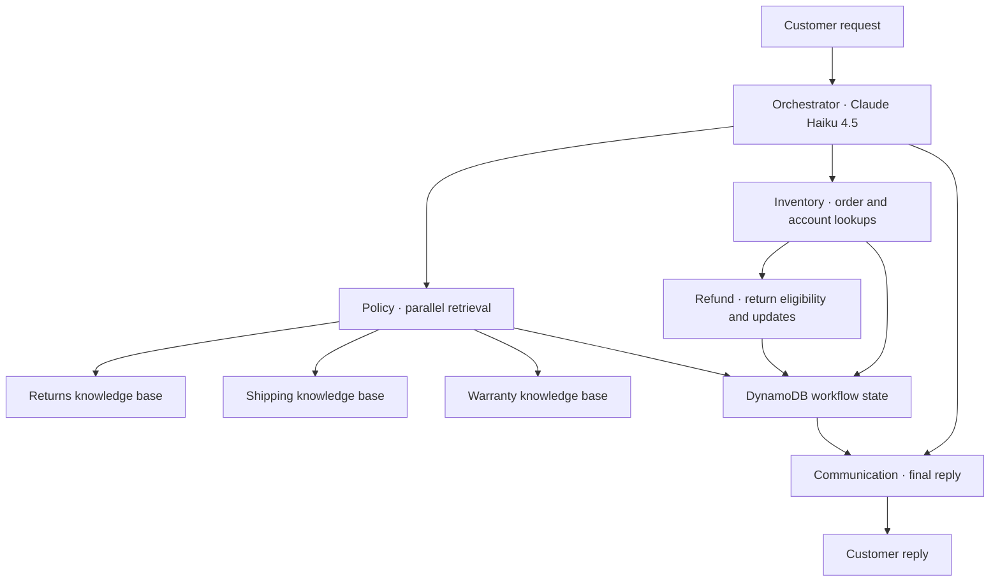

# NovaMart · Multi-Agent Customer Support

NovaMart is an e-commerce customer support prototype built with Python, the Strands Agents SDK, and Amazon Bedrock AgentCore. It looks up orders, answers questions from returns, shipping, and warranty documents, and starts eligible mock returns using synthetic customer data.

**120/120 on the Udacity rubric script** in the AWS sandbox on November 6, 2026. [Grading output](diagrams/udacity-120-score.png) · [X-Ray service map](diagrams/xray-service-map.png)

## What it does

| Customer asks | What NovaMart does |
| --- | --- |
| “Where is order ORD-27177?” | Looks up the order under the current customer and reports its status. |
| “I want to return order ORD-27176.” | Checks the stored order and account tier, then records an eligible return and issues a reference. |
| “What is the warranty policy?” | Searches the policy knowledge bases and answers from retrieved passages. |
| “What’s the total for five items at $29.99 with 10% off?” | Sends the calculation to the Communication Agent. The verified hosted example returned **$134.96**. |

## Architecture



Anthropic Claude Haiku 4.5 selects the route. Claude Sonnet 4.5 powers the worker agents through Amazon Bedrock. Account queries use Inventory, order and return queries use Inventory followed by Refund, and policy queries use Policy. Communication runs last and reads the findings stored for the session.

- **Return updates** use a Python tool that checks delivery status and the return window (30 days for Standard, 60 days for Premium). A conditional DynamoDB write prevents duplicate updates. Repeat requests reuse the existing return reference.
- **Policy retrieval** runs three specialist retrievers in parallel against Bedrock Knowledge Bases backed by S3 Vectors. The Policy Agent builds its answer from the passages they return.
- **Runtime and tracing** use Bedrock AgentCore, Bedrock Guardrails, CloudWatch, and X-Ray. The trace map shows the orchestrator, workers, and policy retrieval calls.

[Agent and tool implementation](src/agent_orchestrator.py) · [Model configuration](config.py) · [CloudFormation template](infrastructure/starter_stack.yaml)

## Run locally and on AWS

Use Python 3.12. For AWS deployment, also install Node.js 20+ and `uv`, and configure AWS credentials and access to the Bedrock models in `us-east-1`. AWS provisioning and model calls can incur charges.

```bash
python -m pip install -r requirements.txt
npm install -g @aws/agentcore@0.30.0
npm ci --prefix agentcore/cdk
```

1. Copy [`.env.example`](.env.example) to `.env`. Copy [`agentcore.example.json`](agentcore/agentcore.example.json) and [`aws-targets.example.json`](agentcore/aws-targets.example.json) to `agentcore.json` and `aws-targets.json` in the `agentcore/` directory. Keep credentials and local deployment settings outside version control.
2. Deploy [the CloudFormation template](infrastructure/starter_stack.yaml) as `udacity-agentcore` with `CAPABILITY_NAMED_IAM`. From the repository root, run `python infrastructure/seed_data.py` to load synthetic orders, customers, and policy documents.
3. Create and sync the three Bedrock Knowledge Bases using the stack’s S3 Vectors indexes and Titan Text Embeddings V2. Follow the [knowledge base setup](UDACITY-STARTER-README.md#task-5---bedrock-knowledge-bases-not-in-starter---done-in-aws-console) and add the three IDs to `.env`.
4. Run `python src/agent_orchestrator.py deploy`. Save the printed runtime ARN and guardrail ID/version in `.env` using the keys in the template.
5. Try a policy question against the deployed runtime.

   ```bash
   python src/agent_orchestrator.py invoke "What is the return policy for Premium customers?" CUST-001
   ```

For an interactive session, run `python src/agent_orchestrator.py chat` after provisioning AWS resources. When finished, run `python infrastructure/cleanup.py` to preview resource deletion.

## Verification

Run the focused tests from the repository root:

```bash
python -m unittest discover -s tests -p 'test_return_rules.py'
python -m unittest discover -s tests -p 'test_refunds.py'
```

After provisioning, run `python src/agent_orchestrator.py test` for live scenarios and `python tests/test_agent.py all` for the full rubric checks. The scenario suite includes a mock return that changes seeded order state.

The November 6 sandbox run confirmed live retrieval from all three policy knowledge bases and checked four hosted routes using the stored workflow state. A lookup with the wrong customer ID returned “Order not found.”

## Scope and attribution

NovaMart is a submitted Udacity capstone that uses synthetic data. The return tool records a return request and reference in DynamoDB. Payment settlement is outside the demo’s scope. Real customer use would require binding the customer ID to an authenticated identity. Arithmetic is model-generated, and conversation-history recall through AgentCore Memory remains unverified.

Based on Udacity’s Multi-Agent E-commerce RAG starter. See the [original project instructions](UDACITY-STARTER-README.md) and [Udacity license](UDACITY-LICENSE.md).
